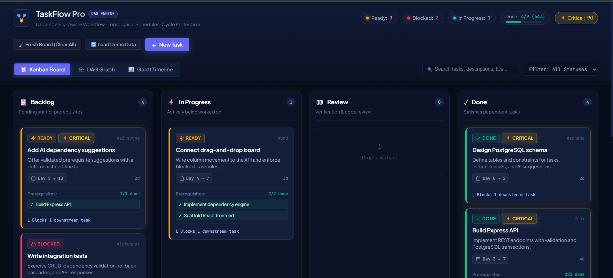

# TaskFlow Pro

> **InnoTech'26 — Software Development Solution**
>
> This project is being developed and presented at the **KIET College
> department-level InnoTech'26 Software Development Solution competition**.

TaskFlow Pro is a dependency-aware project management board built around a
directed acyclic graph (DAG). Unlike a standard Kanban board, tasks can have
finish-to-start prerequisites. The application recalculates schedules,
identifies blocked work, prevents circular dependencies, and highlights the
critical path across three complementary views.

## Highlights

- **Kanban board** with Backlog, In Progress, Review, and Done columns.
- **Dependency-aware status** for Ready, Blocked, and Done tasks.
- **Drag-and-drop workflow** with optimistic updates and rollback on API
  validation errors.
- **Interactive DAG view** with dependency edges, upstream/downstream
  relationships, and critical-path highlighting.
- **Gantt timeline** with schedule propagation and converging dependency paths.
- **Critical Path Method (CPM)** to show the longest dependency chain.
- **AI-assisted dependency suggestions** using Gemini or Anthropic when
  configured, with a deterministic keyword-based fallback.
- **Dependency management** in the task editor, including cycle protection.
- **Search and status filtering** across the board.
- **Keyboard-friendly dialogs** with Escape-to-close behavior and focus
  restoration.

> **Scope:** The current application provides one shared board. Authentication,
> user workspaces, real-time multi-user synchronization, and calendar-aware
> dates are not included.

## Live deployment

The project is configured for separate frontend, API, and PostgreSQL services:

- Frontend: [taskflow-pro.vercel.app](https://taskflow-pro.vercel.app)
- API health check: [taskflow-pro-1-z3zn.onrender.com/health](https://taskflow-pro-1-z3zn.onrender.com/health)

The backend may take 30–60 seconds to wake up on the free Render tier. If the
first request fails, wait briefly and refresh.

## Application views

### Kanban board

The board shows live task metrics and supports:

- Moving tasks between workflow columns.
- Searching by title, description, or ID.
- Filtering by status or critical path.
- Viewing prerequisite completion ratios.
- Seeing how many downstream tasks a task can block.

### DAG graph

The graph presents tasks in topological execution tiers. It makes
prerequisites, dependents, and the critical path easier to inspect than a
linear board.

### Gantt timeline

The timeline displays integer day offsets rather than calendar dates. When a
task has multiple prerequisites, its schedule starts after the latest
prerequisite finishes:

```text
earliest start = max(prerequisite end dates) + 1
```

## Architecture

```text
React + Vite frontend
        │
        │ JSON REST API
        ▼
Express 5 backend ─── PostgreSQL
        │
        └── DAG engine
            ├── topological scheduling
            ├── dependency cycle detection
            ├── blocked-state evaluation
            └── critical-path calculation
```

### Repository structure

```text
taskFlow-pro/
├── assets/                       # Product screenshots used in documentation
├── backend/
│   ├── config/db.js              # PostgreSQL pool and schema initialization
│   ├── src/engine.js             # Scheduling and DAG algorithms
│   ├── src/seed.js               # Benchmark data seeder
│   ├── src/server.js             # Express API and validation
│   ├── package.json
│   └── nodemon.json
├── frontend/
│   ├── src/
│   │   ├── components/
│   │   │   ├── Board.jsx         # Kanban board and drag-and-drop
│   │   │   ├── BoardColumn.jsx   # Droppable workflow column
│   │   │   ├── SchematicView.jsx # SVG DAG visualization
│   │   │   ├── TaskCard.jsx      # Task card and dependency indicators
│   │   │   ├── TaskModal.jsx     # Create/edit/dependency management
│   │   │   ├── TimelineView.jsx  # Gantt timeline
│   │   │   ├── TitleBlock.jsx    # Header, metrics, filters, and actions
│   │   │   └── Toast.jsx          # Notifications
│   │   ├── api.js                # REST API client
│   │   ├── App.jsx               # Application state and view switching
│   │   ├── app.css               # Component and layout styles
│   │   └── theme.css             # Design tokens and global styles
│   ├── index.html
│   ├── package.json
│   └── vite.config.js
├── render.yaml                   # Render service configuration
└── README.md
```

## API

| Method | Endpoint | Purpose |
| --- | --- | --- |
| `GET` | `/health` | Check API and database connectivity |
| `GET` | `/board` | Return tasks, dependencies, computed dates, and statuses |
| `POST` | `/board/reset-seed` | Replace the board with the benchmark workflow |
| `POST` | `/board/clear` | Remove all tasks and dependencies |
| `GET` | `/critical-path` | Return the longest dependency chain and duration |
| `POST` | `/tasks` | Create a task |
| `PATCH` | `/tasks/:taskId` | Update task details and schedule inputs |
| `DELETE` | `/tasks/:taskId` | Delete a task; use `?cascade=true` for downstream unlinking |
| `POST` | `/tasks/:taskId/move` | Move a task between board columns |
| `POST` | `/dependencies` | Add a cycle-safe prerequisite relationship |
| `DELETE` | `/dependencies/:taskId/:prerequisiteId` | Remove a dependency |
| `POST` | `/ai/suggest-dependencies` | Generate prerequisite suggestions |
| `POST` | `/ai/suggestions/:suggestionId/decide` | Accept or reject a suggestion |

## Local development

### Prerequisites

- Node.js 20 or newer
- npm 9 or newer
- PostgreSQL 14 or newer

### 1. Clone the repository

```bash
git clone https://github.com/maharshi027/taskFlow-pro.git
cd taskFlow-pro
```

### 2. Configure PostgreSQL

Create a database:

```sql
CREATE DATABASE taskflow;
```

Create `backend/.env`:

```env
PORT=5000
DB_HOST=localhost
DB_PORT=5432
DB_NAME=taskflow
DB_USER=postgres
DB_PASSWORD=your_postgres_password
FRONTEND_ORIGIN=http://localhost:5173
```

AI suggestions work without an API key using the offline fallback. To enable
provider-backed suggestions, add one or both providers:

```env
GEMINI_API_KEY=your_gemini_api_key
GEMINI_MODEL=gemini-2.5-flash
ANTHROPIC_API_KEY=your_anthropic_api_key
ANTHROPIC_MODEL=claude-sonnet-4-6
AI_TIMEOUT_MS=8000
```

The API initializes its tables automatically on startup.

### 3. Install and start the backend

```bash
cd backend
npm ci
npm run seed       # Optional: load the benchmark workflow
npm run dev
```

The API runs at `http://localhost:5000`.

### 4. Install and start the frontend

In a second terminal:

```bash
cd frontend
npm ci
```

Create `frontend/.env`:

```env
VITE_API_URL=http://localhost:5000
```

Start Vite:

```bash
npm run dev
```

Open `http://localhost:5173`.

## Available scripts

### Frontend

Run these commands from `frontend/`:

```bash
npm run dev       # Start Vite development server
npm run build     # Create a production bundle
npm run lint      # Run oxlint
npm run preview   # Preview the production bundle
```

### Backend

Run these commands from `backend/`:

```bash
npm run dev       # Start API with nodemon
npm start         # Start API in production mode
npm run seed      # Reset and populate benchmark data
npm test          # Run the Node test runner
```

## Data and scheduling rules

- Dependencies are finish-to-start relationships.
- A task cannot be moved into an invalid state when its prerequisites are
  incomplete.
- Adding a self-link or a dependency that creates a cycle is rejected before
  persistence.
- Start and end values are integer day offsets, not calendar dates.
- Duration must be between 1 and 365 days.
- Deleting a task cascades its stored dependency records at the database level.
- Moving a completed prerequisite backward can re-block downstream tasks.

## Deployment

`render.yaml` defines:

- A Node web service for the backend.
- A static site for the frontend.
- A managed PostgreSQL database.

For a production deployment, configure the backend database variables,
`FRONTEND_ORIGIN`, and the frontend `VITE_API_URL` in the hosting provider.
Never commit `.env` files or API keys.

## Screenshots




## License

This repository does not currently define a license. Contact the repository
owner before redistributing or using it outside the project.
